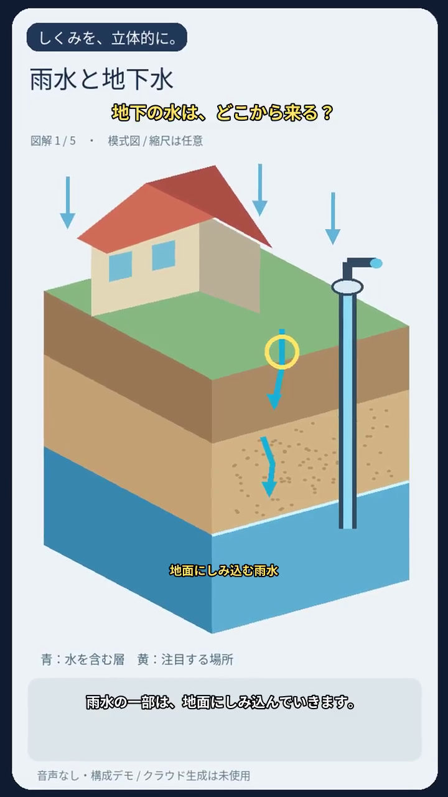

# 3D図解解説 — 3D-

テーマから **台本 → 断面図画像 → ナレーション → 字幕・ラベル・ズーム演出 → CapCutドラフト／MP4** を作る独立アプリです。他の制作リポジトリのコード・Python環境・DBは不要で、ClipForge本体は変更しません。

静止画にキーフレームを付けた立体風の図解です。実際の立体モデルや水の物理シミュレーションを生成するものではありません。30秒・5シーンは目安で、不足による停止・水増し・自動再生成はありません。

## まず、クラウドを使わずデモを作る

Python 3.11以降、FFmpeg/FFprobeが必要です。MP4出力には字幕描画対応のFFmpegを使ってください。

```powershell
git clone https://github.com/nyu1791-collab/3D-.git
cd 3D-
py -3 -m venv .venv
.\.venv\Scripts\python -m pip install -r requirements.txt
.\.venv\Scripts\python main.py demo --output C:/work/3d-demo --mode mp4
```

「雨水が地下水になるまで」の自作模式図5枚、字幕、ラベル、ズーム／パンを含む約30秒の縦動画を作ります。**デモの音声は無音の尺合わせ素材です。Googleの画像生成・音声合成・課金APIは呼びません。** 既存のデモ素材は再利用します。

出力した `result.json` にMP4の保存場所を記録し、端末にも表示します。



## CapCutドラフトも作る

```powershell
.\.venv\Scripts\python -m pip install -r requirements-capcut.txt
.\.venv\Scripts\python main.py demo --output C:/work/3d-demo --mode both --drafts-dir "C:/実際のCapCutドラフト保存先"
```

CapCutの設定画面に出るドラフト保存先を使ってください。画像・音声・編集可能な字幕・ラベル・ズームのタイムラインを、新しい名前で作成します。利用した素材もドラフト内へコピーし、既存のプロジェクトや元素材を上書きしません。CapCutで開いて調整し、最終書き出しはアプリから行います。別PCへドラフトを移す場合は、そのPC上で生成するか素材参照を再設定してください。

## Google接続を使う制作

```powershell
.\.venv\Scripts\python -m pip install --upgrade -r requirements-google.txt
Copy-Item .env.example .env
```

CapCutドラフトを出す `draft` / `both` では、上の `requirements-capcut.txt` もインストールしてください。`mp4` はCapCutなしで出力できます。

`.env` に自分のAI Studioキー、使用するCloudプロジェクト、CapCutドラフト保存先を設定します。APIキーはGitへ入れません。Cloud側は既存のADCまたはWIFを使い、サービスアカウントの長期JSON秘密鍵は新規発行しません。

```powershell
gcloud auth application-default login
gcloud auth application-default set-quota-project project-fdadb4dd-cb77-4270-9cd
```

Cloud側で使うAPI・請求先・権限の準備は [Googleの接続と料金](docs/GOOGLE.md) を参照してください。このアプリはAPIの有効化や権限付与を勝手に行いません。

設定の既定値は次のとおりです。

| 工程 | 経路・モデル |
|---|---|
| 台本とシーン分割 | AI Studio / `gemini-3.8-flash` |
| 断面図画像 | Cloud / `gemini-2.5-flash-image` |
| ナレーション | Cloud Text-to-Speech / `ja-JP-Neural2-C` |
| タイムライン | pyCapCut 0.0.4 またはローカルFFmpeg |

ユーザー案の旧Imagenモデルと旧Vertex SDKは、公式の退役情報に合わせて既定実装から外しました。画像方式・モデルは設定で明示できますが、失敗時に別モデルへ暗黙で切り替えません。[参考元と整合性](docs/SOURCES.md)

### 台本だけ作る

```powershell
.\.venv\Scripts\python main.py generate "家の断熱材が熱の移動を抑える仕組み" --output C:/work/insulation --mode plan
```

これは台本の要求だけです。画像と音声はまだ生成しません。`plan.json` のナレーション、シーン、画像プロンプト、ラベル、動きを編集できます。

### 素材と動画を作る

```powershell
# 素材だけ
.\.venv\Scripts\python main.py generate "家の断熱材が熱の移動を抑える仕組み" --output C:/work/insulation --mode assets
# 画像・音声からドラフトまで
.\.venv\Scripts\python main.py generate "家の断熱材が熱の移動を抑える仕組み" --output C:/work/insulation --mode draft
# MP4とドラフトの両方
.\.venv\Scripts\python main.py generate "家の断熱材が熱の移動を抑える仕組み" --output C:/work/insulation --mode both
```

同じテーマ・設定なら、成功済みの台本、画像、音声を再利用します。自分で編集した台本を使うときは `--plan C:/work/insulation/plan.json` を指定してください。編集したナレーションや画像プロンプトなど、入力が変わった素材だけを新しく生成します。

自分の設定は `config/default.yaml` をもとに `config/local.yaml` に保存し、次のように指定します。

```powershell
.\.venv\Scripts\python main.py --config config/local.yaml generate "テーマ" --output C:/work/new-job --mode both
```

字幕・ラベルの色、大きさ、位置もこの設定で変更できます。位置は画面中心が0、右・上が＋1、左・下が−1です。ラベルは台本のシーンごとの指定を優先します。

## 保存済み素材から作る・途中を続行する

```powershell
.\.venv\Scripts\python main.py resume C:/work/insulation
.\.venv\Scripts\python main.py jobs
.\.venv\Scripts\python main.py build --plan C:/work/plan.json --assets C:/work/assets --output C:/work/local-build --mode mp4
```

既存素材は `scene-001.png` と `scene-001.wav` の組で用意します。シーン番号は台本の `scene_number` に対応します。画像と音声がそろっていないシーンは理由を残し、そろったシーンを使います。取得済みの素材や以前の出力は保持します。

台本の取得中に通信が止まった場合も `resume` で続行できます。同じ素材・設定でMP4かドラフトの片方が完成していれば、それを再利用し、未完了の出力だけを進めます。

作業記録は既定で `~/.3d-explainer/pipeline.sqlite3`、成功済み素材のキャッシュもそのフォルダに保存します。`EXPLAINER_DATA_DIR` で変更できます。ジョブの `request-usage.jsonl` にはモデル、経路、使用量、試行回数を記録し、APIキーやトークンは記録しません。

## 複数テーマを進める

```powershell
.\.venv\Scripts\python main.py batch config/batch.example.yaml --workers 1
```

サンプルは台本のみの `mode: plan` です。画像・音声も生成するときは各項目のmodeを変更してください。テーマ間の並列数と、テーマ内の素材生成並列数（設定の `workers`、既定2）は別です。

## 料金・字幕・表現

- AI Studioの無料枠はモデル・ティア・利用状況によって条件が異なります。Cloud画像生成やTTSの無料枠・クレジット適用も、請求先の実際の条件によります。「完全無料」「クレジット消費ゼロ」とは自動判定しません。
- 画像を動かす疑似3Dです。スクリーンショットのような写実的な見た目は、画像モデル・プロンプト・素材に依存します。
- 字幕はナレーション音声の実尺に合わせます。取得していない単語時刻を作って、単語カラオケができたとは扱いません。
- 目標の尺・シーン数・演出量は停止条件にしません。品質監査、追加査読モデル、完成映像の検査工程は追加していません。

構成は [設計](docs/DESIGN.md)、Google接続は [接続と料金](docs/GOOGLE.md)、公開リポジトリから取り入れた範囲は [参考元](docs/SOURCES.md) にあります。

自作素材でMP4とCapCutドラフトを出力しました。Googleの実生成、無料枠・クレジット適用、Windows版CapCutでの表示は未実施です。

## 書き出し品質

MP4は `src/explainer/ffmpeg_recipes.py` で書き出します。静止画は4倍に拡大してから動かすので、Ken Burns がガタつきません。ナレーションは -14 LUFS にそろえ、BT.709 タグと faststart を付けます。`config/default.yaml` の `quality`（draft / standard / high）と `encoder`（libx264 / h264_nvenc）で速度と画質を選べます。`bgm` にファイルを指定すると、ナレーション中は自動で音量が下がるBGMを重ねます。代表的な1枚を `thumbnail.jpg` に保存します。

## ずんだもん解説の自動投稿（完全自動）

毎朝、テックニュースを集めて、ずんだもんと四国めたんの掛け合いで解説する動画を1本作り、YouTube と X に投稿します。自分のチャンネルだけに関わる処理なので、承認なしで最後まで進みます。

```
情報収集（ITmedia・GIGAZINE・Publickey の RSS、Hacker News）→ 記事本文の取得
→ 台本（Gemini。記事にないことは言わない）→ 記事ページのスクリーンショット（Playwright）
→ 音声（VOICEVOX）→ 画面の合成（引用ページ＋出典＋キャラクター＋字幕帯）
→ 1920×1080 で書き出し → サムネイル → YouTube 公開 → X 投稿
```

- 手元で試す: VOICEVOX を起動してから `python main.py zunda --output out/zunda --no-publish`（書き出しまで）。
- 毎日の実行: `.github/workflows/zundamon.yml`（07:13 JST）。手動実行では「投稿しない」も選べます。
- 同じ日に2回は投稿しません。使った記事は45日間は選びません。新しい話題が無い日は投稿しません。
- 説明欄に記事ごとの目次（YouTube のチャプター）を自動で入れます（3つ以上・各10秒以上のときだけ）。
- 鍵が登録されるまでは毎日の実行は「休止中」と表示して終わり、VOICEVOX も起動しません。
- 失敗したとき: ページが撮れなければ見出しカードで代わりにします。台本・音声・書き出し・アップロードが失敗した日は何も投稿せず、記事は翌日以降にまた候補になります。

### 画面と構成の工夫（量産判定を避け、見やすくする）

- **1行ごとに画面が変わる**: 記事の冒頭（見出しから）、段落を赤枠で囲んでズーム、記事の画像、記事を上から流す、記事内の表（1行ずつ表示）、棒グラフ（伸びる）、要点の箇条書き（1つずつ表示）、引用カードを、台本の内容に合わせて切り替えます。同じ画面が続く行は、ズームした位置のまま止めます。
- **作り話を画面に出さない**: 引用は記事に同じ文字列がある場合だけ、グラフの数値は記事に同じ数字（2.5、3万9800、1億2000万なども判定）がある場合だけ表示します。確認できないものは記事ページの表示に置き換えます。
- **番組ならではの視点**: 毎回3行以上の「考察」（なぜ重要か、誰に影響するか、注意点、今後の見どころ）を、事実と分けて話します。専門用語の言い換えと身近な例えも入れます。
- **形式の日替わり**: 3本まとめ・1本深掘り・Q&A を曜日で回し、直近10回のタイトルと似ないようにします（`zunda.format` で固定も可）。
- **見せ方**: 記事の切り替わりにチャプターカード、字幕の【大事な語】を黄色で表示、話者ごとの字幕色、話している方を明るく表示します。表情別の立ち絵（`zundamon_happy.png` など）があれば、表情を切り替えます。
- **背景テーマ**: 既定は黒板（木枠・チョーク受け・チョーク文字）。`zunda.theme` で whiteboard / gradient、`zunda.background` で自前の背景画像も使える。記事ページはテープで貼った紙のように表示。
- **透明性**: 説明欄に、合成音声であること・考察は番組の見方であること・出典の一覧・目次を入れます。


| Secret | 内容 |
|---|---|
| `GEMINI_API_KEY` | Google AI Studio の API キー（台本） |
| `YOUTUBE_CLIENT_ID` / `YOUTUBE_CLIENT_SECRET` | Google Cloud の OAuth クライアント（デスクトップ アプリ）。ClipForge と同じものでよい |
| `YOUTUBE_REFRESH_TOKEN` | 手元で `python main.py zunda-auth --client-id … --client-secret …` を実行し、**ずんだもん用チャンネル**で許可して得たもの |
| `X_API_KEY` / `X_API_SECRET` / `X_ACCESS_TOKEN` / `X_ACCESS_SECRET` | ずんだもん用 X アカウントのアプリキー（Read and write） |
| `ZUNDA_GITHUB_TOKEN` | このリポジトリの **Variables: Read and write** を持つ fine-grained token（使った記事の記録） |
| `ZUNDA_CONFIG`（任意） | 設定の上書き。例: `zunda: {keywords: [AI, 半導体], topics: 3, privacy: public}` |

`gh secret set 名前 --repo nyu1791-collab/3D-` で登録します（値は画面に出しません）。YouTube API の有効化と OAuth 同意画面の設定は ClipForge の `docs/AUTOPILOT.md` と同じです。同意画面は「本番環境」にしてください（「テスト」のままだと7日で失効します）。

### 守っていること・注意

- **クレジット**: 説明欄に「VOICEVOX:ずんだもん / VOICEVOX:四国めたん」を必ず入れます（利用規約）。立ち絵を使うなら `assets/zunda/zundamon.png`・`metan.png`（透過PNG）を置き、作者の規約に従って `zunda.portrait_credit` に表記を書いてください。無い場合は色付きの名前バッジを表示します。
- **出典と引用**: スクリーンショットには必ず「出典: ドメイン」を表示し、説明欄に記事タイトルとURLを並べます。台本は記事の要点を自分の言葉で説明し、本文を長く読み上げません。主役は解説で、ページは引用として添えるだけです。
- **YouTube API の制約**: Google の API 監査を通るまで、API でのアップロードは**強制的に非公開**になります。既定の割り当て（1日10,000ユニット）では、アップロードは1日およそ6本までです。カスタムサムネイルは確認済みチャンネルでのみ設定されます（失敗しても投稿は続けます）。
- **X**: プランごとの投稿上限に注意してください。投稿できなかった日も、動画の公開はそのままです。

## 関連リポジトリ

制作パイプライン全体の構成と各リポジトリの役割は [ClipForge の README](https://github.com/nyu1791-collab/ClipForge#関連リポジトリ) を参照してください。
