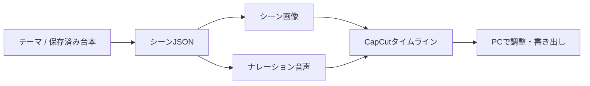

# 断面図解の解説動画

`3D-` はテーマから図解解説を作る独立したアプリです。ClipForge本体や他の制作リポジトリのソース・Python環境・DBを使いません。切り抜きの工程を統合して、既存のClipForgeを変更する構成にはしません。

## 制作の流れ

台本にはタイトル、冒頭のフック、シーン番号、ナレーション、画像プロンプト、ラベル、ラベル位置、カメラの動きを持たせます。画像・音声はシーンごとに保存し、取得済みファイルを使って続行します。台本だけを直したい、画像だけ用意したい、ローカルの素材だけでドラフトを作りたい操作を分けます。

30秒・5〜6シーンなどは制作目標です。目標に届くまで生成を繰り返す処理、目標不足による素材破棄、追加モデルによる査読や監査、完成動画の全デコード検査は追加しません。通信や認証が失敗した工程は記録し、取得済みの素材を保持します。必要な素材がないシーンは理由とともに省き、使えるシーンを残します。

## 見た目と時間軸

- 画像は3D風の断面図・俯瞰図を作り、ズーム・パンのキーフレームで動きを付けます。これは静止画像を動かす**疑似3D**で、立体モデルや液体の物理シミュレーションを生成したことにはしません。
- 説明ラベルは画像に文字を焼き込ませる設計にせず、独立したテキストトラックに配置します。画像の生成文字が読めない場合も、ラベルを編集できます。
- ナレーションは音声ファイルの実際の長さを使って順に置きます。各画像と字幕をそのシーンの時間へ合わせ、30秒に合わせるための架空の時刻を作りません。
- 編集可能字幕はシーン・発話単位です。単語タイムスタンプを取得していない音声へ、単語単位のカラオケ同期を付けたとは扱いません。必要のないASRを標準工程へ足しません。
- ドラフトは新しい名前で作り、利用した素材もドラフト内へコピーします。既存プロジェクトと元画像・元音声を上書きしません。

## 接続と使用量

台本のAI Studio経路とGoogle Cloud側の画像・音声経路を明示して使います。接続先が利用できない場合、別のキーや別モデルへ自動で切り替えません。モデル名、工程、試行回数、成功・失敗、取得できた使用量を記録し、秘密値や全文を使用量ログへ混ぜません。

Google Cloudの無料枠・クレジットは課金設定の条件です。シーンを生成できたことだけで「無料だった」「クレジットが残っている」と判断しません。提案にあった旧Imagen・旧Vertex SDKの扱いは [参考元と整合性](SOURCES.md) にまとめています。

## 扱う題材

「雨水が地面にしみ込む」「家の断熱材が熱の移動を抑える」など、仕組みを段階で示せる題材に向いています。シーンでは全体像、断面、注目箇所、流れ、まとめを順に見せられます。科学的な細部は台本と素材として与えた情報の範囲で表現し、生成した断面画像を実測の構造図や観測映像と称しません。

実際のキー設定、操作コマンド、出力場所はREADMEを参照してください。本番のGoogle API生成とCapCut実機での表示を実施していない段階では、その成功を報告しません。
